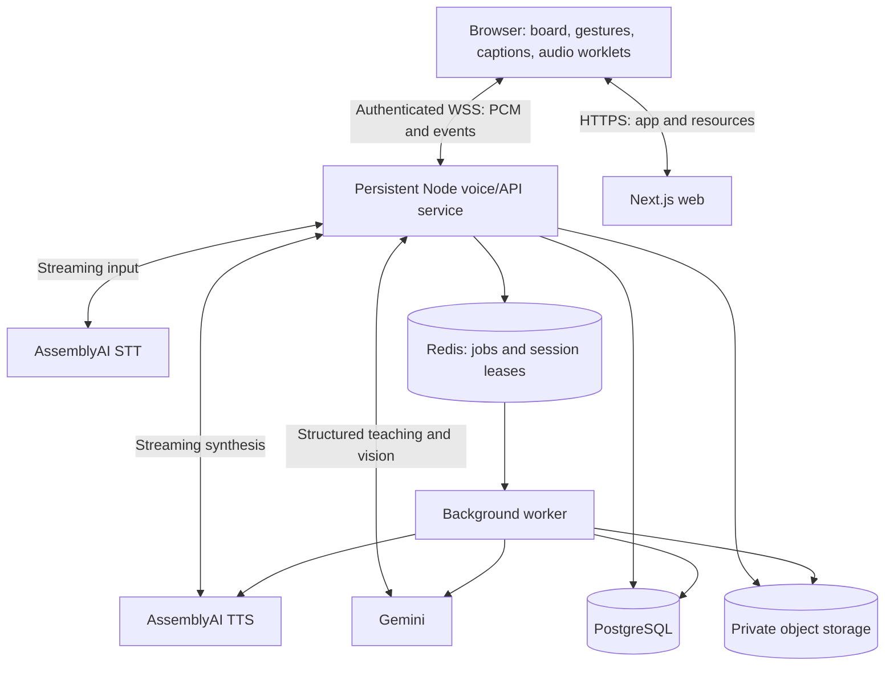

# Tokai — complete implementation plan

**Prepared:** 3 November 2026, Asia/Kathmandu.  
**Repository reviewed:** `F:\tokai-agora`, HEAD `31f6c24`.  
**Target event:** [AssemblyAI — Voice hackathon week: Hack into speech](https://luma.com/msrwwjby).  
**Scope:** Build the complete Tokai learning application from a clean product architecture, using the existing prototype as a reference and preserving its provenance. This is an implementation specification, not a claim that the features already work.

## Current implementation decisions (user instructions, 3 November 2026)

The user has updated the infrastructure choices while retaining the complete product scope:

- **Convex is the database and durable AI background-job platform.** Use transactional Convex functions, scheduled actions, owner-scoped storage, job receipts/retries and native file storage. PostgreSQL/Drizzle/pgvector and Redis/BullMQ references below describe the original proposal and are superseded by equivalent Convex implementations.
- Complete and verify the application locally first. After completion, deploy the **website to Vercel** and use Vercel's deployment/build workflow. **Do not add GitHub Actions.** Current Vercel Functions support WebSockets; the selected release design hosts Fastify as a Node service with bounded connection rotation, private file transfers and durable Convex coordination. Linux native processing and free-plan deployment limits must pass release checks before publishing.
- Continue and push each completed implementation phase. Phases 3 and 4 have been pushed at `1baa9f4` and `7ffa8a1` respectively.
- Demo videos, submission materials and organizer submission remain deferred. Preserve the existing free-account preference; no billing upgrades or paid fallback.

## 1. Product direction and hackathon fit

Build **Tokai: a voice-first AI tutor that speaks, draws, listens, and checks understanding together**.

The student should experience a patient private tutor: ask a question aloud, watch a diagram develop as the tutor explains it, interrupt naturally, point at the confusing part, answer a follow-up question, and leave with a reusable study pack. Speech must drive the learning experience rather than narrate a conventional chatbot response.

The full scope includes all capabilities promised by this repository: live voice tutoring, an editable teaching whiteboard, hand gestures, concept maps, interactive 3D models, flashcards, and session summaries. It also includes the supporting functionality needed to make those features a coherent app: onboarding, accounts and guest access, lesson planning, source-grounded teaching, saved sessions, assessment, revision scheduling, spoken recaps, accessibility, persistence, observability, deployment, and a credible demo.

Phases below express implementation dependencies. They are **not** a reduced hackathon edition or a list of features to abandon when time gets short. A complete app means every specified user journey works; it does not mean unlimited curriculum coverage or fabricated provider capabilities.

### 1.1 What the event actually says

The organizer's [Luma event page](https://luma.com/msrwwjby) identifies AssemblyAI as presenter and focuses on products using its new Text-to-Speech API. It describes an online event, teams of 1–4, and $2,000 in prizes distributed across 20 winners. Accessibility and voice applications are explicitly relevant. The page does not publish a complete judging rubric or submission specification.

**There is a date discrepancy.** On 3 November, the page's description still listed October 15–23. Its embedded `__NEXT_DATA__ → props.pageProps.initialData.data.event` instead contained:

| Field | Raw value | Nepal time |
|---|---|---|
| `start_at` | `2026-10-28T02:00:00Z` | 28 October, 07:45 |
| `end_at` | `2026-11-07T19:00:00Z` | 8 November, 00:45 |
| Event timezone | `America/Los_Angeles` | Store timestamps in UTC; display locally |

This is evidence of the current event schedule, **not verification of the submission deadline**. Confirm that deadline and the authoritative rules through the organizer's [linked Discord community](https://discord.com/invite/P7sKN78EsE). Do not schedule submission from stale prose or assume event end equals submission close.

Record these unanswered items in `docs/hackathon/requirements.md` when implementing:

- Exact submission deadline, timezone, submission URL, required fields, video format/length, and judging access.
- Formal judging criteria, eligibility/geography/age requirements, and team registration rules.
- Whether existing projects and code can be extended; what must be created during this event.
- AI coding-agent policy and disclosure expectations. Do not assume agents count as human teammates or that their use is prohibited.
- Which AssemblyAI integration is formally mandatory; whether sponsor credits and quotas require activation.
- Any public repository, source license, asset attribution, or recording obligations.

These unknowns do not prevent architecture and implementation planning. They do prevent asserting eligibility or marking submission requirements complete.

### 1.2 Repositioning from Agora to AssemblyAI

| Existing framing | Target framing and implementation |
|---|---|
| An Agora hackathon voice demo | A complete learning product built around AssemblyAI speech |
| Agora hosted ASR/LLM/TTS pipeline | Owned tutoring orchestrator with AssemblyAI streaming STT and TTS |
| Rime/Astra speech in README | AssemblyAI voice selected from its documented catalog |
| Images generated when a keyword appears | Structured teaching steps with editable visuals and coordinated speech |
| Gesture annotation followed by a separate screenshot question | A shared reference context connecting speech, selected shapes, and gestures |
| Transcript in a side panel | Accessible captions, turn history, and a learning record |
| One live conversation | Diagnostic → lesson → practice → recap → scheduled review |

The primary demo must use AssemblyAI TTS for the tutor, follow-up questions, and spoken recap. Also use AssemblyAI STT for incoming speech. Merely adding sponsor branding, transcribing with AssemblyAI while another provider speaks, or pre-generating a greeting would not substantiate this product direction. This is our strategic recommendation, not an invented official eligibility rule.

Agora can remain a transport adapter for future shared tutoring sessions. It is not necessary for the primary one-student experience. The existing backend does **not** support AssemblyAI TTS by changing an environment variable: its `build_tts_config` accepts ElevenLabs, OpenAI, Cartesia, and Rime. Hosted Agora compatibility requires a separate verified integration; do not invent a vendor string.

### 1.3 The distinctive experience

Use **voice-paced teaching steps** as the central product idea. Each step combines a short spoken explanation, a board change, a concept reference, and optionally a question. The student can interrupt, ask “why this?”, or select a diagram part without losing the lesson context.

The standout demonstration is a misconception being corrected: a student circles a chloroplast, asks whether it absorbs food from soil, and the tutor stops, uses the selected object to clarify the misunderstanding, changes the diagram, and asks the student to explain it back. The recap records the actual misconception and the student's subsequent answer.

## 2. Repository audit: what exists and what does not

This plan is based on source inspection, manifests, repository history, documentation, and the onboarding/annotation screenshots. Existing provider integrations were not exercised with live credentials, and a production build was not run. “Present” below means source exists, not runtime verification.

### 2.1 Inventory

| Path | Actual role and findings | Treatment |
|---|---|---|
| `README.md` | Strong product vision, old Agora event details, screenshots, and demo link; run instructions reference missing top-level directories | Preserve original claims as historical context; rewrite after implemented behavior is verified |
| Root `package.json` | Template metadata; `setup` points at absent `update-templates.js`; not a product workspace | Replace with workspace tooling during foundation work |
| `Hackathon-Rating-Rubric.md` | Rubric for Agora Singapore; requires Agora technologies and TRAE IDE | Historical artifact; never apply its requirements or weights to AssemblyAI |
| `Agora-Voice-AI-Quickstart.md`, `Thought_Starters.md` | Agora starter/reference material | Retain with clear provenance |
| `.agents/skills/agora/` | Agora-specific implementation references | Use only for an actual Agora adapter |
| `agent-samples/AGENT.md`, `CLAUDE.md` | Sample-specific integration guidance, including environment profiles | Read before modifying retained sample code |
| `agent-samples/react-voice-client/` | Actual partial Tokai application; Next.js 16.1.6, React 19.2.1, tldraw 4.5.8 range, Tailwind 4 | Source for product styling and interaction references |
| `components/VoiceClient.tsx` | Tokai shell, connection form, voice controls, transcript, whiteboard, camera component, canvas sharing | Split into focused new product modules |
| `hooks/useAgoraVoiceClient.ts` | RTC microphone/audio, RTM login, transcript and agent messaging, cleanup/state | Reference lifecycle patterns; replace primary transport |
| `components/Whiteboard.tsx`, `hooks/useWhiteboard.ts` | tldraw mount and basic shape helpers | Rebuild behind a typed board adapter and verified tldraw API |
| `hooks/useDiagramGenerator.ts`, `lib/gemini.ts` | Keyword-triggered Gemini bitmap generation inserted into canvas | Replace main teaching path with semantic editable diagrams; keep illustration generation server-side |
| `hooks/useCanvasAnalysis.ts` | Screenshot capture and Gemini vision description | Replace browser provider call with authorized server grounding |
| `hooks/useHandGestures.ts`, `components/GestureCamera.tsx` | Browser MediaPipe recognition, drawing/pan callbacks, camera UI | Retain conceptual approach; rebuild calibration, state, and accessibility |
| `agent-samples/simple-backend/` | Python Flask/Lambda Agora token/config/agent lifecycle backend | Reference only for optional Agora transport |
| `agent-samples/simple-backend/tests/` | pytest tests for sample config, tokens, agent, endpoints, utilities | Retain historical tests; they do not validate Tokai tutoring |
| Other voice/avatar clients, recipes, Shen/Thymia assets | Starter demonstrations outside Tokai's learning workflow | Keep outside new application dependencies |
| `images/` | Existing visual evidence and design reference | Do not present as screenshots of the new build |

### 2.2 README feature gap matrix

| Capability | Current evidence | Required implementation |
|---|---|---|
| Voice conversation | Agora hooks/client source exists | AssemblyAI voice loop, interruption, recovery, measured latency |
| Live teaching board | Canvas and generated bitmap insertion exist | Validated editable board operations coordinated with spoken teaching |
| Gesture input | Browser-side MediaPipe exists | Stable drawing, pointing, selection, calibration, intentional confusion signal |
| Custom LLM server and tool suite | Claimed server is absent | Server orchestrator, schemas, tool dispatcher, session context |
| Python gesture server | Claimed directory is absent; actual tracking runs in browser | Keep browser-local tracking; no redundant Python camera server |
| Structured concept map | No implemented React Flow/Dagre map found | Graph model, stable layout, merge/reset, mastery/question states |
| 3D visualization | No implemented viewer/model catalog found | GLB catalog, viewer, semantic parts, controls and fallback |
| Flashcards | No persisted tool/UI found | Generation, editing, grounded answers, review scheduling |
| Session summary | No end-to-end implementation found | Durable summary job, evidence, exports and spoken recap |
| Saved learning progress | No product database/auth layer found | Ownership, sessions, attempts, mastery, resume and deletion |

### 2.3 Problems to avoid carrying forward

1. `NEXT_PUBLIC_GEMINI_API_KEY` in client code makes a configured provider key public. Move every paid provider credential to server-only configuration. If such a key was previously deployed, rotate it; source inspection alone does not establish whether one was exposed.
2. `next.config.ts` suppresses TypeScript build errors. Restore strict compilation; correct incompatible shape props and browser APIs instead of retaining the bypass.
3. The UI kit depends on GitHub `#main` and a postinstall script. New application code should use pinned registry releases or an explicitly pinned commit, with reviewed patches only when necessary.
4. Lockfiles are ignored in the current repository. Commit a workspace lockfile and enforce frozen installs.
5. Sample backend mutation routes use GET, permissive CORS, debug-server behavior, and verbose payload logging. Do not deploy them as the new public API.
6. Browser screenshot conversion uses `Buffer`; use supported browser Blob/ArrayBuffer APIs instead of relying on a Node polyfill.
7. Current camera controls include placeholder behavior; “off” must actually stop camera tracks and inference.
8. Keyword triggers do not understand educational intent, and a generated image has no stable concept/shape identity. Use a semantic scene model.
9. The current fixed desktop split and developer-facing backend/profile fields are inappropriate for student onboarding.
10. Dependencies, model names, and screenshot claims are historical. Verify compatibility and actual account access before pinning the new build.
11. The existing client accepts a query-supplied `returnurl` for navigation. Remove this behavior or restrict it to approved same-origin destinations.
12. Existing leave/join-failure paths need explicit microphone track stop/close and rollback. The new state machine must unwind partially established connections and reap orphaned provider sessions.

The actual legacy web development port is **8083**, with the backend under `agent-samples/simple-backend`; the root README's port/directory instructions do not describe this checkout. Existing PM2/start scripts contain `/home/ubuntu/...` paths and references to missing services. Write portable new setup/deployment instructions. Preserve a tracked `.env.example` explicitly despite legacy `.env*` ignore patterns. No repository/root `AGENTS.md` or root license file was found during this review; create guidance for the new workspace and establish its licensing deliberately.

### 2.4 Preserve provenance and originality

Keep `agent-samples/` as reference during the new implementation. Create `docs/provenance.md` listing upstream sample code, existing Tokai modifications, new work, assets, licenses, and the starting commit. Preserve the Agora sample's MIT attribution when reusing it. Check rights to Tokai-specific code/assets separately; an upstream license is not proof that every addition has identical licensing.

Do not describe an extended prototype as wholly created during this hackathon. If rules require newly written application code, implement the new `apps/` and `packages/` modules afresh and disclose the earlier concept/reference. Do not delete history to imply originality. Confirm whether the idea itself or prior submission affects eligibility.

## 3. Complete user journeys and screens

### 3.1 New student

1. Open the landing page, understand what Tokai does, and choose a sample lesson or their own topic.
2. Continue as a scoped guest or sign in. Explain what persists for each mode.
3. Choose level, learning goal, available lesson length, language, voice, and accessibility preferences.
4. Run an explicit microphone/output check. Camera is optional and requested only when enabling gestures.
5. Hear a brief introduction and answer one diagnostic question.
6. Enter the learning workspace with a clear objective and first board frame.

### 3.2 Learning session

1. Speak or type a question; partial captions appear immediately.
2. Tutor teaches in brief steps using appropriate diagrams, formulas, examples, and questions.
3. Student can interrupt, slow down, repeat, request another example, or say “explain this” while selecting a shape.
4. An uncertain reference triggers a clarification, not a guessed explanation.
5. Concept map records introduced concepts and verified understanding; flashcards become available without interrupting instruction.
6. Student can open a 3D model when spatial explanation is useful, with the tutor referring to named parts.
7. A short exercise checks transfer to a new example before the tutor moves on.
8. End session saves progress and creates a study pack, even when a secondary generation job fails and needs retry.

### 3.3 Returning student

Dashboard shows recent lessons, unfinished sessions, due review cards, and concepts needing practice. Resume restores the board and learning state, but does not replay stale audio. Review accepts a spoken or typed answer, gives a grounded explanation, updates scheduling, and links back to the lesson evidence.

### 3.4 Screen map

| Route | Main responsibilities |
|---|---|
| `/` | Clear product promise, sample topics, start action, privacy/accessibility entry points |
| `/learn/new` | Topic/source selection, goals, level, voice settings, device check |
| `/learn/[sessionId]` | Whiteboard, tutor controls, captions, selected-object context, study tools |
| `/dashboard` | Resume, recent sessions, due reviews, progress overview |
| `/library` | Search/filter saved lessons, notes, decks and uploaded sources |
| `/sessions/[sessionId]` | Summary, transcript, board history, sources, study pack and exports |
| `/review` | Spaced review queue, spoken/typed recall, feedback |
| `/settings` | Voice, language, accessibility, account, retention and deletion |
| `/share/[shareToken]` | Explicitly shared read-only study pack; revocable and privacy-filtered |
| `/ops` | Role-protected provider health, failures, usage, version information; no student UI exposure |

Use the existing forest-green/cream Tokai identity, readable typography, and restrained motion. Desktop has a resizable board and study panel, with persistent voice controls. Mobile switches between Board, Transcript, Map, and Review without unmounting the active session. Make camera preview collapsible. Developer configuration belongs in environment settings or protected diagnostics.

## 4. Architecture and technical decisions

### 4.1 Selected stack

| Layer | Decision | Reason |
|---|---|---|
| Workspace | pnpm workspaces, TypeScript, committed lockfile | Shared contracts and predictable AI-agent integration |
| Web | Next.js App Router, React, Tailwind, accessible headless primitives | Existing team/repository familiarity and rich client workspace |
| API + voice runtime | Long-running Node.js service using Fastify and WebSockets | Own the audio lifecycle, cancellation, authenticated sessions and backpressure |
| Background jobs | Convex scheduled actions with durable receipts and bounded retries | Summaries, ingestion, audio exports and retries without delaying voice; bounded local compute handles native parsing |
| Speech | AssemblyAI streaming STT + AssemblyAI streaming TTS | Central sponsor integration with independently controlled tutoring |
| Tutor/vision model | Gemini via current server-side SDK, configurable model IDs | Structured tool calls and multimodal grounding; preserve conceptual fit |
| Board | tldraw behind `BoardAdapter` | Editable shapes, selection, drawing, persistence and export |
| Concept map | React Flow + Dagre initially | Graph rendering with deterministic layout |
| Spatial scenes | Three.js / React Three Fiber + glTF loader | Interactive, semantic 3D model catalog |
| Gestures | MediaPipe in browser, worker where supported | Webcam frames need not leave the device |
| Database | Convex transactional document database and vector indexes | Durable owner-scoped learning records, events, fencing and source retrieval |
| Authentication | Managed OIDC provider; server-verified sessions plus scoped guest sessions | Avoid writing password storage; provider selected/configured in foundation |
| Assets | Convex native file storage behind authorized download routes | Private documents, exports and opted-in recap audio |
| Testing | Vitest, Playwright, axe, integration containers and recorded protocol fixtures | Contracts, real browser audio state, isolation and accessibility |
| Operations | OpenTelemetry-compatible traces, structured logs, error reporting | Correlate latency, failures, cost, and turn outcomes |

Pin supported versions after a compatibility smoke test. The existing version numbers are audit findings, not a recommendation to remain on those exact patches. Current [Next.js installation documentation](https://nextjs.org/docs/app/getting-started/installation) should govern the selected runtime requirements. Record Node/pnpm versions in repository tooling and CI.

tldraw's [current license terms](https://tldraw.dev/community/license) require an appropriate production license/key. Resolve this before deploying the canvas. If that cannot be obtained, implement the same `BoardAdapter` contract using a permitted alternative and run the same behavior tests; do not remove the whiteboard or bypass license enforcement.

### 4.2 Deployment topology



Use HTTPS/WSS everywhere outside localhost. Run the voice service on a host that explicitly supports long-lived WebSockets and suitable idle limits. A Next.js frontend deployment does not automatically provide a persistent voice server. A container platform or VM can host the API/worker; choose region near the intended audience and speech endpoints after measuring latency.

Each live session has exactly one orchestrator owner. Redis stores an expiring ownership lease; PostgreSQL holds durable state. Do not put audio chunks into Redis or PostgreSQL. Route reconnects to the current owner where possible; after ownership loss, restore durable state and establish a new voice epoch.

Lease expiry alone is insufficient: assign each ownership acquisition a monotonically increasing fencing generation. Check that generation on durable writes, event publication and socket routing. The previous owner must stop provider work immediately when renewal fails, and the gateway/client must reject output from its obsolete generation even if the old process resumes. Ownership generation and output epoch solve different problems; retain both.

### 4.3 Target repository layout

```text
tokai-agora/
  imp.md
  AGENTS.md
  package.json
  pnpm-workspace.yaml
  pnpm-lock.yaml
  .env.example
  apps/
    web/
      app/
      components/{onboarding,workspace,board,map,models,review,history}/
      hooks/{useVoiceSession,usePlaybackClock,useSelectionContext}/
      workers/{microphone.worklet,playback.worklet,gestures.worker}/
    api/
      src/{auth,http,ws,sessions,voice,tutor,tools,grounding,telemetry}/
    worker/
      src/jobs/{ingestSource,finalizeSession,generateRecap,exportStudyPack}/
  packages/
    contracts/       # Zod schemas, versioned envelopes, OpenAPI/shared types
    tutor-core/      # lesson state, policies, prompts, deterministic evaluators
    speech/          # AssemblyAI adapters, audio framing, provider capabilities
    board/           # semantic scene, commands, renderer adapters and snapshots
    learning/        # assessment, evidence, mastery and review scheduler
    db/              # schema, migrations, tenant-scoped repositories
    ui/              # Tokai design system
    fixtures/        # synthetic lessons, audio/protocol fixtures, example scenes
  content/
    lessons/{photosynthesis,fractions,solar-system,circuits}/
    models/          # manifests; large assets live in object storage
  tests/{contract,integration,e2e,evals,load}/
  infra/{docker,compose,deploy}/
  docs/{architecture,hackathon,runbooks,provenance}/
  agent-samples/     # preserved historical/reference code
  images/           # original screenshots, clearly labeled historical
```

Do not bulk-move or delete the sample tree as a prerequisite. Establish the new product beside it. Only the new workspace packages participate in product builds.

## 5. AssemblyAI voice implementation

### 5.1 Provider integration comes first

Create `scripts/verify-speech.ts` as an opt-in integration probe. With developer credentials it must synthesize one short utterance, stream microphone/fixture input to STT, exercise cancellation, and record the negotiated format and request IDs without logging secrets. Credentials/account access have not been verified during this planning task.

The [AssemblyAI TTS quickstart](https://www.assemblyai.com/docs/tts/getting-started/quickstart) documents HTTP synthesis and WebSocket sessions; TTS support begins at JavaScript SDK 4.42.0 and Python SDK 1.8.2. For this TypeScript stack, select and lock a compatible JavaScript release. Use the documented `assemblyai-tts-1` model and a verified voice ID, rather than copying the README's Rime settings.

Store a provider capability record: streaming input/output, encoding, sample rate, language/voice compatibility, cancellation behavior, word timings, request limits, concurrency and account quotas. Validate this against current docs and the probe. Provider outages or missing credentials should produce actionable diagnostics, never silently substitute another vendor while displaying AssemblyAI as active.

### 5.2 Browser input and output

Use `wss://tts.us.assemblyai.com/v1/ws` for the selected US TTS region and the documented regional equivalent if choosing another region. Initial output is mono 24 kHz signed 16-bit little-endian PCM; validate the actual `Begin` configuration before decoding. The provider's TTS socket uses JSON text frames, including encoded audio payloads; the API adapter decodes these and forwards application-owned binary audio frames to the browser. Do not send our binary protocol directly to the TTS provider. See the [TTS WebSocket reference](https://www.assemblyai.com/docs/tts/api-reference/websocket-api) and [message frames](https://www.assemblyai.com/docs/tts/message-frames).

- Request microphone permission from a user action. Enable browser echo cancellation/noise suppression when supported; expose device selection and a push-to-talk mode.
- Capture actual AudioContext sample rate, resample deliberately, and send mono PCM in the format accepted by the selected STT configuration. Do not label 48 kHz data as 16 kHz.
- Use AudioWorklet capture and playback, bounded ring buffers, binary frames, sequence numbers, and explicit stream/session metadata.
- Decode TTS output according to the negotiated codec. For PCM output, convert samples to the playback format; never repeatedly treat raw PCM bytes as independent WAV files.
- Resume AudioContext after user interaction, surface autoplay restrictions, and handle output-device changes and suspended tabs.
- Monitor network buffering and playback underruns. Stop accepting unbounded work when queues exceed limits; show recovery state instead of accumulating seconds of obsolete speech.
- Stop tracks, worklets, sockets, timers, and provider sessions on explicit end, sign-out, navigation cleanup, and expired sessions. A server idle reaper covers abandoned browsers.

### 5.3 Turn orchestration

Maintain explicit states:

`idle → connecting → listening → recognizing → thinking → speaking → listening`, with `interrupted`, `reconnecting`, `paused`, `error`, and `ended` transitions.

1. Local voice activity may interrupt output quickly; provider endpointing commits the student's utterance.
2. Store partial transcripts as replaceable UI state. Commit a finalized utterance once using provider turn identity and a revision policy.
3. Package finalized text, lesson state, selected objects, recent board version, relevant source excerpts, and recent conversation for the tutor.
4. Generate and validate one short teaching step, then continue incrementally. Avoid waiting for an entire lesson before speaking.
5. Apply the step's permitted visual operations and stream its narration to TTS.
6. Track generated, played, interrupted, and completed narration separately.
7. Accept typed messages through the same orchestrator; text must not create a second conversation history.

An STT formatting update must not trigger another tutor response. Repeated WebSocket delivery must not create duplicate questions, diagrams, or flashcards.

For AssemblyAI STT, explicitly pin the supported streaming model after probing; the current [model-selection guide](https://www.assemblyai.com/docs/streaming/select-the-speech-model) recommends `universal-3-6-pro`. Confirm the negotiated model from `Begin`. In its [turn-detection protocol](https://www.assemblyai.com/docs/streaming/turn-detection), use `SpeechStarted` as a provider interruption signal and a `Turn` with `end_of_turn: true` to commit input. Partial text replaces the prior partial for that turn. Provider speech-start recognition is not an instantaneous acoustic signal, which is why local detection remains useful for fast interruption. Tune endpointing for students pausing to think, using settings documented for the pinned model. Implement and test binary PCM framing against the [STT message sequence](https://www.assemblyai.com/docs/streaming/message-sequence); start with roughly 50 ms capture chunks and benchmark latency/overhead.

### 5.4 Barge-in and cancellation

Use a monotonically increasing `outputEpoch` for each session. On confirmed interruption:

1. Immediately mute/clear queued browser playback and cancel pending visual cues for the old epoch.
2. Increment the epoch and mark the turn interrupted.
3. Abort in-flight LLM generation and tool work where supported.
4. Send the TTS provider's cancellation command and honor its cancellation acknowledgement.
5. Discard late old-epoch audio, tool results, and timing events.
6. Preserve already displayed board content; do not roll back the student's annotations.
7. Tell the tutor what the student actually heard, using playback acknowledgements, rather than treating the entire generated answer as delivered.

Debounce local speech detection and test echo-induced false interruptions on laptop speakers. Offer a push-to-talk fallback. “Stop” as a control must work even when transcription is unavailable.

### 5.5 Voice and visual synchronization

Introduce application-owned `TeachingBeat` objects:

```ts
type TeachingBeat = {
  beatId: string;
  turnId: string;
  outputEpoch: number;
  spokenText: string;
  displayText: string;
  conceptIds: string[];
  boardCommands: BoardCommand[];
  question?: PublicAssessmentQuestion;
  sourceRefs: SourceRef[];
};
```

Use short sentence/clause-sized requests. Apply a beat's visual setup immediately before its audio starts, after validation and board readiness. Associate audio, transcript, board operations, and subsequent assessment with the same beat ID. Do not use an independent timer to guess when an entire explanation has finished.

`PublicAssessmentQuestion` contains only the assessment ID, prompt, response format and visible choices. Keep answer keys, hidden rubrics, grading instructions and unrevealed hints server-side; serialize an explicit public projection rather than sending the internal assessment object to the browser.

**Provider timing constraint:** AssemblyAI [word boundaries](https://www.assemblyai.com/docs/tts/word-boundaries) arrive after the corresponding `FlushDone`, rather than word by word during generation. Match using `flush_id`; timestamps are on the provider session timeline. Compute request-relative time as `word.start - audio_start_ms`, then anchor that offset to the actual browser playback start for that request. Cancelled output still affects the provider timeline. Enable boundaries explicitly in SDK configuration.

Consequently, live teaching should use beat-level synchronization. Apply word highlights only when timings arrive in time for future playback. A precise read-along mode can buffer each short request until timings are available; label and measure its additional startup latency. Saved recap playback can use complete timings. Do not claim perfectly timed live word highlights for audio already played, and skip invalid/zero-length timing spans.

### 5.6 Teaching voice design

Create a small curated set of verified catalog voices; use the [voice catalog documentation](https://www.assemblyai.com/docs/tts/voices) to map valid `voice_id` values and supported languages. Let learners preview them. Persist voice choice and speaking preferences.

Use plain spoken language: expand math symbols, abbreviations and units into intelligible speech while preserving mathematical display text. Separate instruction, worked example, question, and silence for thinking. Offer concise, detailed, slower, and repeat modes through application planning and supported provider settings. Do not assume undocumented emotion controls, arbitrary SSML, or languages unsupported by the chosen voice/model.

A requested pause can be implemented as playback scheduling silence. Do not send a made-up `[pause]` tag expecting provider control. Never infer a student's emotion or disability from their voice; difficulty adaptations should use explicit preferences and learning evidence.

### 5.7 Targets and measurements

These are engineering targets, not existing results or provider guarantees:

| Metric | Initial target | Measurement |
|---|---|---|
| End of student speech → first audible tutor response | p50 ≤ 1.5 s; p95 ≤ 3 s for ordinary uncached questions | Browser timestamps plus endpointing, LLM, TTS and network spans |
| Interruption → playback silence | p95 ≤ 200 ms locally | Local VAD/control event to final output sample |
| Beat visual/audio skew | p95 ≤ 150 ms | Board-ready acknowledgement versus scheduled playback start |
| First usable lesson screen | ≤ 3 s on representative desktop connection | Real navigation measurement with lazy-loaded 3D/gesture modules |
| Normal conversation success | ≥ 95% across the defined evaluation set | Completed objective without manual repair |
| Session isolation | Zero cross-session data/audio delivery | Adversarial integration tests |

Report cold starts, warm sessions, network conditions, device, model, sample count, p50 and p95 separately. A slow board/image generation path must not block all spoken interaction.

### 5.8 Provider lifecycle and language boundaries

The [TTS message protocol](https://www.assemblyai.com/docs/tts/message-frames) uses `Generate`, `Flush`, `Cancel`, `KeepAlive`, and `Terminate`. `Generate` adds text; `Flush` closes a synthesis request. `FlushDone` means socket delivery completed, not that the learner heard the speech. Maintain an explicit mapping from provider connection ID plus `flush_id` to application beat and output epoch; a connection rotation starts a new ID namespace. Serialize cancellation and new output, and keep dropping old-epoch frames even after a cancel is sent.

The documented [TTS limits](https://www.assemblyai.com/docs/tts/limits) include 2,000 Unicode code points per `Generate`, 8,000 pending characters, a default 120-second idle timeout and one-hour session lifetime. Runtime `Begin` limits/expiry govern the actual connection. Queue only a few short teaching requests, use idle keepalives appropriately, and rotate before expiry at a safe turn boundary. Session-creation rate limits are not concurrent-session allowances. Handle structured errors and test cleanup when rotation fails.

The [TTS API reference](https://www.assemblyai.com/docs/tts/api-reference/websocket-api) documents English, Spanish, German, Italian, Portuguese and French. Its language parameter uses full names, not locale codes; do not infer TTS language support from the larger STT language set. Start with English and implement a verified language/voice capability matrix for the others. Nepali/Hindi speech must not be advertised as supported by this integration. Voice/language/format changes require replacing the provider session at a controlled boundary. Unsupported language selections should be disabled with a clear explanation; localized text support is a separate capability.

Keep the server-relay design as the single primary route. A future direct-browser transport using provider temporary tokens would need separate quota/security evaluation; it is not required to build this complete application.

## 6. Tutor intelligence and pedagogy

### 6.1 Session context

Persist the student's goal, chosen level, lesson outline, known prerequisites, diagnosed misconceptions, current concept, unresolved questions, attempts, and preferences. Separate long-term learning evidence from ephemeral provider transcripts. A compact summary plus relevant retrieved evidence bounds model context; do not resend an unbounded transcript every turn.

Use a single authoritative tutoring state machine with modular planning/grounding/assessment functions. Multiple autonomous runtime agents should not simultaneously control the same voice or board. Coding agents can build modules in parallel; runtime conversational ownership remains singular.

### 6.2 Teaching policy

1. Establish the objective and ask a short diagnostic question.
2. Explain one conceptual step at a time.
3. Ask a question that reveals understanding, then wait.
4. On an incorrect answer, identify the misconception, offer a hint, and ask a related question before giving a full worked solution.
5. Honor explicit requests for a direct answer or worked example; Socratic teaching must not become refusal to help.
6. Use examples appropriate to the declared level, not inferred personal traits.
7. Mark a concept understood only from assessment evidence, never because it was mentioned or the student said “okay.”
8. Distinguish known source evidence, inference, and uncertainty. Correct a previous error explicitly and update affected study material.
9. End with a brief retrieval question and next step.

### 6.3 Model and tool control

Use the server-side Gemini SDK and its documented [function calling](https://ai.google.dev/gemini-api/docs/function-calling) support. Choose a model that passes text, vision, schema, tool, and latency probes for the account. Keep `TUTOR_MODEL` and `VISION_MODEL` configurable and version prompts/evaluation outputs. Do not hard-code historical preview model names without checking availability.

The model proposes actions; application code validates, authorizes, and executes them. Limit tool calls per turn, parameter sizes, total generation time, retry count, and cost. One repair attempt for invalid output is reasonable; repeated invalid output becomes a useful text-only explanation and a visible tool error, not an infinite loop.

### 6.4 Tool contracts

| Tool | Important arguments | Validation and result |
|---|---|---|
| `draw_shapes` | `beatId`, expected board version, typed create/update operations, concept links | Allowed geometry, bounds, IDs, command limits; returns applied IDs and new version |
| `highlight_concepts` | Shape/concept IDs, style, duration | Existing IDs only; returns cue ID |
| `update_mind_map` | Nodes, edges, merge/replace mode, topic ID | No dangling edges, stable IDs, replace scope checks; returns graph version |
| `show_3d_visualization` | Catalog model ID, semantic part IDs, camera preset | Allowlisted assets and parts; returns scene state |
| `ask_question` | Concept, question, answer rubric, hints, source refs | Grounded answer criteria; returns assessment ID |
| `evaluate_answer` | Assessment ID, student answer, evidence references | Server-owned grading logic/model rubric; returns feedback and evidence |
| `generate_flashcards` | Concept IDs, evidence refs, count, card kinds | Deduplication, bounded count, editable output; returns card IDs |
| `generate_session_summary` | Session ID, covered turns/concepts | Idempotent background job; returns job ID |
| `set_lesson_focus` | Goal/current concept, next step | Allowed state transition; returns new lesson version |

Tools cannot execute arbitrary JavaScript, fetch arbitrary model-supplied URLs, access another student's content, or select database tenant IDs. Use JSON Schema/Zod contracts, explicit error codes, idempotency keys and audit events.

## 7. Whiteboard and visual teaching

### 7.1 Semantic scene model

Store an application-level scene independent of tldraw internals: `Scene`, `Frame`, `ConceptObject`, `Connector`, `Label`, `Equation`, `Illustration`, and `Annotation`. Each object has a stable ID, semantic description, concept/source links, author, revision, and optional accessibility description. Map this model to renderer shapes through `BoardAdapter`.

Required board interactions: draw, select, move, erase, undo/redo, zoom/pan, fit current frame, frame navigation, reset with confirmation/undo, keyboard shortcuts, touch/stylus input, export, and persistence. Separate student annotations from tutor-generated shapes so later AI updates cannot silently erase student work.

### 7.2 Visual generation pipeline

1. Select a diagram template based on teaching intent: process flow, comparison, hierarchy, timeline, labeled anatomy, number line, fraction model, graph or equation derivation.
2. Ask the model for semantic content and relationships, not arbitrary rendering code.
3. Validate content, units, references and shape count.
4. Perform deterministic layout, text measurement, collision avoidance and viewport fit.
5. Render an editable scene and create the corresponding accessible text description.
6. Emit readiness acknowledgement so speech and visuals can coordinate.

Use illustrations for concepts that need imagery, but keep labels and important conceptual structure editable. Store generated assets server-side with provenance. Slow image generation runs asynchronously and announces its status; it does not block follow-up questions.

For math, use a safe equation renderer and deterministic calculation where practical. Preserve step IDs, units, assumptions and source expressions. Never allow model-generated raw HTML/SVG scripts or arbitrary code execution.

### 7.3 Board grounding

“Explain this” context contains selected shape IDs, selected concept IDs, viewport, board version, recent pointer/gesture target and a short look-back timestamp. Prefer semantic object data. Use a bounded screenshot crop only when interpreting handwriting, a raster image or ambiguous annotation requires vision. Require an explicit share action or clearly disclosed session setting for image transmission.

If a selection is stale or contains several equally likely targets, ask the student which one they mean. Treat text found in uploads/board images as lesson content, not instructions that can change tool permissions.

### 7.4 Board concurrency

Apply tutor changes as versioned transactions. If the student edits the affected object during generation, reject/rebase the stale tutor transaction rather than overwrite it. Snapshot periodically and append operations between snapshots. Undo should distinguish local student actions from tutor-generated batches. Test duplicate, out-of-order and interrupted operations.

## 8. Gestures and natural pointing

Use the [MediaPipe web gesture recognizer](https://developers.google.com/edge/mediapipe/solutions/vision/gesture_recognizer/web_js) for landmarks/recognized gestures. Pin model/WASM assets to compatible versions and self-host reviewed assets where possible. Inference must not starve audio playback; benchmark worker support and use a throttled main-thread fallback if needed.

Implement:

- Explicit enable/disable, live permission state and camera track cleanup.
- Calibration for mirrored video, camera dimensions, canvas rectangle, zoom and pan.
- Smoothed pointer motion, confidence threshold, dwell/hysteresis and a dead zone.
- Intentional index-finger draw; closed-fist pan; pinch selection/zoom; model rotation in 3D mode.
- Open-palm “I need help” only in a clearly enabled gesture mode with dwell/cooldown. Do not fire on every frame or unexpectedly change tools.
- Clear on-screen feedback showing recognized gesture, active mode, target and pending action.
- Selection-confirmation step for ambiguous circles; a circle is not automatic proof of confusion.
- Equivalent mouse, touch, keyboard and voice controls for every gesture action.

Camera frames stay local by default. Send semantic selections and gesture actions, not raw continuous video. Do not attempt emotion recognition. Provide good behavior for no camera, low light, occlusion, left-handed use, multiple hands, camera unplug and model-load failure.

## 9. Concept map and learning state

Implement a graph with stable concept IDs and typed relationships such as prerequisite, part-of, causes, contrasts-with and example-of. Node types include root, concept, detail and question. Keep pedagogical status separate: introduced, practiced, needs-help and demonstrated-understanding.

Merge new nodes incrementally; preserve manual positioning and minimize layout shifts. Reset only the relevant topic graph when topic changes. Cross-links are valid: layout should handle graphs rather than assume a perfect tree. Selecting a node focuses associated board objects, transcript evidence, questions and flashcards.

Use color plus icons/text, not color alone. Provide a keyboard-navigable list representation for screen readers. A “needs-help” mark comes from an explicit request or assessment evidence. Store its reason and allow it to be resolved after successful practice.

## 10. Interactive 3D learning

Build a catalog-driven viewer, not unrestricted arbitrary 3D generation. Initial complete examples: solar system, DNA, a plant cell/chloroplast, and a clearly labeled educational heart model. The README's solar system/DNA/heart scenarios must all work. Curate or create assets with suitable rights, and validate scientific labels.

Each model manifest includes asset URL, checksum, license/attribution, unit/scale conventions, semantic parts, camera presets, accessibility descriptions, animation states, performance budget and 2D fallback. Map `partId` to actual mesh/group names so the tutor can reliably highlight “Earth,” “base pair,” or “left ventricle.”

Support orbit, zoom, reset, label toggles, isolation/highlighting, pointer selection and corresponding gesture controls. Dispose GPU resources when closing or swapping models. Lazy-load assets and cap texture/geometry size. Handle WebGL loss and unsupported devices with a labeled diagram plus equivalent textual explanation. Model accuracy and illustrative scale must be clear.

Do not show a blank viewer for an unsupported topic: explain the limitation and continue with a diagram. A complete visualization system does not require a 3D model for every possible subject.

## 11. Sources, lesson content and grounding

Support topic-only lessons and student-provided PDF, image, or text sources. Use authenticated upload initialization, file/type/size checks, private storage and a background ingestion job. Parse pages, retain page/section anchors, OCR scanned pages when needed, chunk content and index embeddings. Treat embedded text as untrusted material.

Retrieval filters by owner and selected lesson sources before ranking. Returned citations include document title, page/section and source snippet. A source-grounded mode answers from provided material and says when it cannot find support; broader explanations are labeled as general knowledge. Do not fabricate page references.

Create four fully authored seed lesson packs: photosynthesis, fractions, solar system and basic circuits. Each contains objectives, prerequisites, diagnostic prompts, common misconceptions, validated explanations, diagrams, question rubrics, cards and source attribution. These are evaluated reference lessons and demo fixtures, not hard-coded substitutes for free-form conversation.

Check formulas and numeric results deterministically when possible. Track model-generated statements requiring verification. If an error is corrected, invalidate/update affected cards, summaries and mastery evidence.

## 12. Assessment, flashcards and retention

### 12.1 Assessment

Support multiple choice, short answer, spoken explanation, diagram labeling and simple numerical problems. Separate answer correctness, reasoning quality and confidence. Use deterministic checks for numeric answers with units/tolerance and model rubrics for open explanations. Show a helpful correction and allow appeal/retry; do not present automated grading as infallible.

Maintain an evidence-based mastery estimate. Start unknown, add evidence from attempts, decay confidence with time, and distinguish assisted answers from independent recall. Version the algorithm. Do not assign a precise ability score from a single interaction.

### 12.2 Flashcards

Generate basic, cloze, diagram-label and spoken-recall cards from covered concepts and cited facts. Store front/back, hint, explanation, source refs, concept IDs, origin turn and revision. Allow edit, discard, merge duplicates, mark incorrect and regenerate. Create cards asynchronously so generation cannot delay voice.

Use a deterministic, documented spaced-review scheduler initially: new/learning/review states, Again/Hard/Good/Easy ratings, interval, due time and lapse count. Store UTC due timestamps and display in the learner's timezone. An established scheduler can replace the first implementation behind the same contract after validation. AI assessment may suggest a rating; the student can override it.

### 12.3 Review workflow

Read the question with AssemblyAI on request, let the student answer before showing the back, grade/compare the response, explain the answer, and update the due date exactly once. Keyboard and text modes remain fully usable. Review history links to the original lesson and its evidence.

## 13. Summaries, spoken recaps, history and export

End-session finalization is idempotent: close audio safely, save final transcript/board version, enqueue learning-material jobs, return a durable session page immediately, and update artifact statuses as jobs finish.

The study pack contains:

- Objective and concepts actually covered.
- Key explanations, formulas, diagrams and linked sources.
- Questions attempted, feedback, misconceptions and unresolved questions.
- Editable notes, flashcards, practice recommendations and next lesson suggestion.
- A concise AssemblyAI-narrated recap with saved caption timings and playback controls.
- Markdown export, printable/PDF view, board PNG/SVG where supported, and flashcard CSV/JSON.

Do not summarize interrupted, unplayed narration as material the learner completed. Preserve partial-session summaries if the connection fails. Audio recap generation is retryable and optional for storage; its failure must not prevent access to the text study pack.

History supports search, topic filters, rename, archive, resume and delete. Sharing is opt-in, read-only, revocable, and excludes private transcripts/uploads by default. Export jobs obey authorization at job creation and download time, and signed URLs expire.

## 14. Data model and persistence

Use UUIDs or another consistently generated opaque ID scheme. Every owner-scoped query must include verified ownership; opaque IDs alone are not authorization.

| Entity | Important fields and relationships |
|---|---|
| `users` | OIDC subject, display name, timezone, created/deleted timestamps |
| `guest_sessions` | Opaque principal, expiry, quota, optional claimed user |
| `learner_profiles` | Owner, level/preferences, accessibility settings, chosen voice/language |
| `lessons` | Owner, title, goal, plan/version, seed pack/source links |
| `sessions` | Owner, lesson, status, current concept, output epoch, last event sequence |
| `turns` | Session, speaker, provider turn key, finalized text, timestamps, delivery status |
| `teaching_beats` | Turn, speech/display text, concept refs, commands, played portion, interruption |
| `session_events` | Session, monotonic sequence, schema version, event ID/type/payload |
| `board_snapshots` | Session, board version, snapshot/object reference, checksum |
| `board_operations` | Session, author, command ID, expected/applied version, operation |
| `concepts`, `concept_edges` | Lesson/topic graph, semantic keys, relation and source refs |
| `assessments`, `attempts` | Rubric/version, answer, feedback, hints used, evidence |
| `mastery_evidence` | Owner, concept, attempt, evidence kind, confidence and timestamp |
| `flashcards`, `reviews` | Owner, content/source refs/version, schedule and rating history |
| `sources`, `source_chunks` | Owner, private object key, parser status, anchors, embeddings |
| `artifacts` | Session, kind, status, version, object key, provenance and retention |
| `share_links` | Owner, hashed token, permitted artifacts, expiry/revocation |
| `usage_events` | Session/provider, measured units, outcome, configured price version |
| `jobs` / job references | Owner, type, idempotency key, status, retry/failure reason |

Use uniqueness constraints for provider-turn commits, command IDs, review submissions and finalization jobs. Index `(owner_id, created_at)`, `(session_id, seq)`, review due times, concept references and source ownership. Persist event + state changes transactionally; use an outbox for job/event publication where needed.

Raw mic audio is not persisted by default. Transcript retention is explicit in onboarding/settings. Guest artifacts expire under a documented policy. Implement deletion across database rows, storage objects, search embeddings, caches and share links; document backup retention separately. Use synthetic data in development/evaluation.

Make deletion race-safe: tombstone the session/owner first, revoke live socket access and sharing, cancel active provider work and queued/in-flight jobs, then remove artifacts. Workers recheck authorization, tombstone state and the expected entity revision before committing output. Reject late writes and clean up any temporary object they created. Retrying a historical job must never recreate a deleted lesson or export. Tombstones contain only the minimum non-content identifiers needed to prevent resurrection.

## 15. API, WebSocket and event contracts

### 15.1 HTTP API

| Endpoint | Behavior |
|---|---|
| `POST /v1/guest-sessions` | Create rate-limited scoped guest principal |
| `GET/PATCH /v1/me/preferences` | Retrieve/update allowlisted learner settings |
| `POST /v1/lessons` | Create topic/source-based lesson and plan job |
| `POST /v1/sessions` | Authorize lesson access and create one session |
| `POST /v1/sessions/:id/connect` | Mint short-lived, single-use socket ticket scoped to owner/session |
| `GET /v1/sessions/:id` | Return authorized resume snapshot and artifact state |
| `POST /v1/sessions/:id/end` | Idempotent close/finalize; return status/job reference |
| `GET /v1/sessions/:id/events?after=...` | Bounded replay of durable events |
| `POST /v1/sources/uploads` | Validate upload intent and return signed private upload target |
| `POST /v1/sources/:id/complete` | Verify object and enqueue ingestion |
| `GET /v1/reviews/due`, `POST /v1/reviews/:id/attempts` | Owner-scoped review and idempotent answer submission |
| `PATCH /v1/flashcards/:id` | Edit content and revise downstream schedule/evidence as required |
| `POST /v1/sessions/:id/exports` | Queue authorized export |
| `POST/DELETE /v1/share-links[/:id]` | Create/revoke narrowly scoped sharing |
| `DELETE /v1/sessions/:id`, `DELETE /v1/me` | Retention-aware deletion workflow |
| `GET /health/live`, `/health/ready` | Minimal liveness/readiness; no secrets or student data |

Generate OpenAPI from contracts. Define structured errors with `code`, safe message, retryability and request ID. Validate bodies, apply body limits/rate limits, enforce ownership and use idempotency keys on retried mutations. Use POST for mutations rather than legacy GET routes.

### 15.2 WebSocket protocol

Use a single authenticated application socket per active browser session initially, with typed JSON control messages and binary audio frames. Validate Origin and a short-lived ticket before accepting; redact tickets from access logs. Reject duplicate consumers or define an explicit takeover flow. Avoid putting durable credentials into socket URLs.

```ts
type ServerEvent<T> = {
  protocolVersion: 1;
  eventId: string;
  sessionId: string;
  ownerGeneration: number;
  seq: number;
  type: string;
  turnId?: string;
  beatId?: string;
  outputEpoch?: number;
  serverTime: string;
  payload: T;
};
```

Client messages: `session.start`, `input.text`, `input.audio.start/end`, `input.interrupt`, `selection.update`, `gesture.action`, `board.operation`, `playback.ack`, `assessment.answer`, `session.pause/resume/end`, `events.ack` and heartbeat.

Server messages: `session.ready/state`, `transcript.partial/final`, `tutor.beat`, `audio.start/chunk/end`, `audio.cancel`, `board.patch`, `map.patch`, `model.show`, `assessment.ready/feedback`, `artifact.status`, `usage.warning`, `error` and heartbeat.

Specify binary headers for stream ID, output epoch, request/beat association, sequence, encoding and sample count. Audio delivery is ephemeral and is **not** replayed after reconnect. Durable events are replayed after the last acknowledged sequence, deduplicated by event ID. A new connection reconstructs a current snapshot before accepting live patches.

Bound frame/body sizes, queue depths and per-user concurrency. If control traffic is delayed behind audio under load, separate audio and control sockets while retaining shared session identity and ordering rules; measure this instead of prematurely adding a second media stack.

## 16. Accessibility, privacy and application security

Accessibility is a product feature, not a claim that gestures are accessible to everyone. Every learning task must work without camera, without speech and without precise pointer motion.

- Keyboard access and visible focus for all controls; escape/close behavior for overlays.
- Text input, captions, replay, mute, speed preferences and readable transcript.
- Semantic board descriptions and navigable object/concept lists for screen readers.
- High contrast, scalable type, reduced motion, no color-only status, touch targets.
- Avoid screen-reader announcements for every partial token; announce finalized meaningful units.
- Explicit media permissions and accurate “recording/listening/camera on” indicators.
- Server-only provider keys; secret scanning; no keys, full prompts, audio or private source text in ordinary logs.
- Server-verified auth, strict ownership, CSRF protection where cookie-authenticated mutations apply, safe CORS, socket Origin checks, rate/usage limits and quota enforcement.
- Sanitize rendered markdown and uploaded content. No unsafe HTML or executable model output.
- Restrict remote asset fetches to approved storage/providers to avoid SSRF; sandbox document parsing with resource limits.
- Encrypt traffic, use private buckets, rotate credentials, audit sensitive administrative actions.
- Disclose the AI tutor and its limitations; provide correction/report controls. For minor/student deployment, resolve applicable consent and school requirements before claiming compliance.

Do not collect medical/psychological biometrics from the sample's wellness modules. Tokai's adaptation needs learning answers and user preferences, not such data.

## 17. Reliability, cost and operations

### 17.1 Failure behavior

| Failure | Expected result |
|---|---|
| Microphone denied/unavailable | Complete text-based session with optional tutor speech |
| Camera denied/model load failure | Mouse/touch/keyboard selection and drawing |
| STT disconnect | Visible reconnect; typed input remains available; no silent loss of finalized turns |
| TTS failure | Show explanation/captions and a retry control; clearly report speech unavailable |
| LLM timeout/rate limit | Cancel stale work, preserve state, bounded retry, useful error |
| Invalid drawing tool output | Reject safely; continue spoken/text explanation without corrupting board |
| Student interrupts during generation | No stale speech/visual changes after epoch cancellation |
| Browser reconnects | Restore snapshot and new audio epoch, never replay old queued audio |
| Worker fails | Artifact marked retryable; lesson and transcript remain available |
| 3D fails | Equivalent 2D/text teaching path |
| Quota reached | Clear remaining state and export access; stop new paid generation gracefully |

Mocks and prerecorded lessons are valid development/demo recovery tools only when clearly labeled. They must never masquerade as successful live provider calls.

### 17.2 Observability and budget

Correlate `sessionId`, `turnId`, `beatId`, provider request IDs and job IDs. Record endpointing duration, first model output, first synthesized byte, first audible sample, buffer depth, interruption delay, tool validation failure and reconnect counts. Protect diagnostic views with roles and redact content.

Meter STT audio duration, TTS billed units from provider responses, LLM tokens, embedding/ingestion work, storage, and egress. Compute per-session cost using a dated configurable rate table; do not bake guessed prices into UI. Add per-user concurrency, daily spend, max session duration, idle timeout and generation-length limits. These are adjustable resource controls, not arbitrary feature cuts.

Cache static lesson assets and repeated non-personal voice previews. Cache personalized artifacts only within the appropriate access scope. Avoid speculative long narration that will often be interrupted and billed without being heard.

## 18. Implementation work packages

Every package below is part of the complete plan. “Depends on” identifies integration prerequisites; UI work may begin against shared fixtures earlier. Suggested owners are roles for coding agents, not additional human hackathon teammates.

### Wave A — facts, contracts and foundations

| ID | Owner | Depends on | Deliverable and acceptance |
|---|---|---|---|
| A01 | Lead | — | Record current event evidence and unresolved rules in `docs/hackathon/requirements.md`; distinguish verified dates from unknown deadline |
| A02 | Lead | — | Baseline/provenance inventory at current commit; all reused code/assets attributed; no historical files deleted |
| A03 | Platform | A02 | New workspace, runtime pins, strict TS/lint, lockfile, environment validation; clean frozen install and production scaffold build |
| A04 | Contracts | A03 | Versioned events, tool schemas, scene model and API schemas with valid/invalid fixtures; web/API share types without circular dependencies |
| A05 | Platform | A03,A04 | Database migrations, private storage, Redis, OIDC and guest identity; two users cannot access each other's seeded records |
| A06 | Speech | A03,A04 | AssemblyAI STT/TTS integration probe with cancellation/format/timing fixtures; evidence captured using real API when credentials exist |
| A07 | Frontend | A03,A04 | Tokai design system, responsive shell, screen routes, loading/error/empty states and keyboard navigation |

### Wave B — one complete voice teaching loop

| ID | Owner | Depends on | Deliverable and acceptance |
|---|---|---|---|
| B01 | Speech | A05,A06 | Authenticated voice socket, provider lifecycle, bounded queues, idle cleanup; unauthorized or expired connection rejected |
| B02 | Frontend/Speech | B01,A07 | Mic worklet, resampling, PCM playback, output-device/autoplay handling; real recorded input and synthesized output play correctly |
| B03 | Speech | B02 | Turn state machine, transcript commit/deduplication, text input parity; one finalized utterance causes one response |
| B04 | Speech | B03 | Epoch-based barge-in, local flush, provider cancel, stale result rejection; interrupted audio never resumes |
| B05 | Tutor | A04,A05 | Lesson planner, session context, prompt versions and tutoring policy; diagnostic/question/wait transitions pass fixtures |
| B06 | Tutor | B03,B05 | Server-side Gemini tool loop and bounded schema repair; normal conversation produces validated teaching beats |
| B07 | Frontend/Speech | B04,B06 | Beat scheduler, playback acks and caption states; already-played versus pending text distinguished |
| B08 | Platform | B01,B06 | Traces, provider request correlation and initial cost meter; one turn can be traced end to end without secret/content leakage |

**Integration gate:** A learner asks a real question, hears AssemblyAI speech, interrupts it, and receives a coherent follow-up with retained context. Capture measured latency before adding concurrency.

### Wave C — visual intelligence and natural interaction

| ID | Owner | Depends on | Deliverable and acceptance |
|---|---|---|---|
| C01 | Visuals | A04,A07 | Board adapter, semantic scene, tldraw license decision, selection and versioned commands; strict build and create/update/delete/undo work |
| C02 | Tutor/Visuals | B06,C01 | Diagram templates, layout, labels and equations; diagrams remain editable and object IDs survive revisions |
| C03 | Visuals/Speech | B07,C02 | Beat/audio/board coordination and timing map; no board operation from cancelled epoch executes |
| C04 | Grounding | C01,B06 | Selection-to-concept grounding plus bounded screenshot vision; “this” resolves correctly or asks clarification |
| C05 | Gestures | C01,A07 | Local MediaPipe calibration, smoothing, draw/pan/select modes and disable cleanup; tested under board zoom and mirrored camera |
| C06 | Gestures/Grounding | C04,C05 | Intentional gesture help and selection context; no repeated prompts from a held gesture; keyboard equivalent passes |
| C07 | Visuals | A04,B05 | React Flow map, stable merge/layout/reset, accessible list; no duplicate nodes or dangling edges |
| C08 | Spatial | A04,A07 | 3D viewer, catalog manifests, four validated model examples and semantic highlights; touch/keyboard/fallback/resource cleanup pass |
| C09 | Tutor | C07,C08,B06 | Map and model tool integration; tutor-selected concepts/parts match rendered objects |
| C10 | Platform/Visuals | C01,A05 | Board snapshots, event replay and edit conflict handling; reload/resume preserves student annotations |

### Wave D — durable learning product

| ID | Owner | Depends on | Deliverable and acceptance |
|---|---|---|---|
| D01 | Content | A04,B05 | Four authored seed lesson packs with objectives, misconceptions, rubrics and sources; subject review completed |
| D02 | Grounding | A05 | Safe document upload, parsing/OCR, chunking/indexing and job statuses; scanned and text PDFs both produce page-linked evidence |
| D03 | Tutor/Grounding | D02,B06 | Source retrieval and cited teaching; absent evidence causes qualification instead of fabricated citation |
| D04 | Learning | A04,A05,B05 | Assessment/rubric engine and attempt storage; correct, incorrect, ambiguous and hinted answers handled distinctly |
| D05 | Learning/Tutor | D04,B06 | Voice/typed/diagram exercises plus feedback loop; successful attempt updates mastery evidence once |
| D06 | Learning | D04,A05 | Flashcard generation/edit/dedupe and deterministic scheduling; duplicate jobs do not duplicate cards |
| D07 | Frontend/Learning | D06,B07 | Review queue with optional spoken questions and answers; reload preserves progress and due dates |
| D08 | Worker | B08,C10,D05,D06 | Idempotent session finalization and grounded summaries; interrupted/partial lessons produce accurate summaries |
| D09 | Worker/Speech | D08,A06 | Spoken recap, stored timing map and replay; transcript/audio align in saved playback |
| D10 | Frontend | D08,C10 | Dashboard, library, search, resume and session detail; guest-to-account claim preserves ownership correctly |
| D11 | Worker/Platform | D08,D09 | Markdown/print/PDF/board/card exports, download authorization and revocable share links |
| D12 | Frontend/Platform | D10,A05 | Preferences, retention, session/account deletion and accessibility settings; settings work across new/resumed sessions |

### Wave E — production behavior and proof

| ID | Owner | Depends on | Deliverable and acceptance |
|---|---|---|---|
| E01 | QA | B04,C03,C10 | Reconnect/interruption/event ordering fault suite; stale audio and duplicate operations never survive |
| E02 | QA/Learning | D01,D03,D05,D08 | Tutoring evaluation suite with human-reviewed references; correctness, grounding and learning outcomes reported |
| E03 | Accessibility | A07,C06,C07,C08,D07 | Keyboard/screen-reader/text-only/camera-free/mobile/reduced-motion audit and fixes |
| E04 | Platform/QA | A05,B01,D02,D11,D12 | Authorization, upload, prompt-injection, secret and privacy tests; no cross-user artifact access |
| E05 | Platform/Speech | B08,E01 | Concurrent-session load test, cost limits, queue backpressure, memory and disconnect soak; measured capacity documented |
| E06 | Platform | E04,E05 | Container deployment, TLS/WSS, migrations, backups/restore, health checks and rollback runbook verified |
| E07 | QA | C09,D11,D12,E03,E06 | Complete browser journey on deployed environment; every original README capability exercised and accessibility gate passed |
| E08 | Lead/Content | A01,A02,E02,E07 | New README, architecture, setup, limitations, sponsor evidence, provenance and submission materials |
| E09 | Lead | E08 | Rehearsed live demonstration, backup recording, organizer-confirmed submission checklist and delivery receipt when actually submitted |

### 18.1 Critical path

`A03 → A04 → A05/A06 → B01 → B02 → B03/B05 → B04/B06 → B07 → C01/C02/C03 → C04/C06 → D04/D05 → D08/D09 → E07/E08/E09`.

Start content, UI, gesture, graph, model catalog and ingestion development against fixtures after A04. Integrate working slices continuously. Do not defer all cross-module integration until every agent reports “done.”

## 19. AI-agent execution strategy

### 19.1 Ownership and parallelism

Use one integration lead with ownership of contracts, architecture decisions and merge order. Keep 3–5 focused implementation lanes depending on available tooling; additional agents can review or build isolated assets/tests. More agents do not remove dependencies or coordination cost.

| Lane | Owned areas | Interfaces consumed |
|---|---|---|
| Platform/integration | Workspace, auth, DB, infrastructure, CI | Contract version and repository conventions |
| Speech | Speech package, voice runtime, browser audio worklets | Session auth, event envelope, teaching beats |
| Tutor/learning | Tutor core, tools, assessment, summaries/cards | Scene/tools, DB repositories, provider adapters |
| Visual frontend | Workspace UX, board, map, 3D | Contract fixtures and adapter interfaces |
| Grounding/gestures/QA | Upload ingestion, selection/gesture modules or focused test assignments | Ownership/auth and event contracts |

Use isolated branches/worktrees when several agents modify code concurrently. One owner controls migrations and one controls shared contracts. A contract change requires fixture updates and a coordinated consumer update; agents must not silently invent near-identical event shapes.

### 19.2 Required task handoff

Each task includes: objective, owned paths, dependencies, exact contract version, existing fixtures, acceptance criteria, test command, prohibited scope changes and expected integration notes. Agent completion includes changed files, commands run/results, manual steps, known limitations and any new environment variables. “Implemented” without integration evidence is not complete.

Example implementation prompt:

```text
Read imp.md, repository AGENTS.md, and docs/architecture/contracts.md.
Implement B04: interruption and cancellation.
Own packages/speech and apps/api/src/voice/cancellation only.
Consume protocol v1 and existing session ownership/auth; do not change event names.
Implement epoch invalidation, provider cancellation, local playback flush command,
and rejection of late audio/tool results. Preserve already-applied student work.
Add tests for late chunks, repeated interrupt, provider cancel failure, and reconnect.
Run the lane's typecheck/tests. Report exact commands and remaining integration work.
Do not replace AssemblyAI with a mock in the production path or expose provider keys.
```

Example reviewer prompt:

```text
Review the merged voice + board slice against B04, C03, and section 15.
Trace one interrupted turn across browser, API, provider callbacks and persistence.
Find stale-epoch updates, timing-origin mistakes, duplicate commits, missing cleanup,
and cross-session access. Supply a reproduction and acceptance test for each issue.
Do not accept a passing mocked demo as proof of live provider interoperability.
```

### 19.3 Integration cadence

1. Freeze schemas and fixtures for a slice.
2. Implement independent lanes in parallel.
3. Merge platform/contracts first, then provider/runtime and UI consumers.
4. Run affected unit/contract/integration checks.
5. Exercise the slice in a real browser with representative data.
6. Fix integration failures before building dependent slices.
7. Record measured behavior and update task status/evidence.

Do not create a date-based promise that every task fits in a guessed number of hours. Estimate work after A06 and the first complete voice slice reveal provider and environment constraints. Maintain the full scope while using parallel work to reduce elapsed time.

## 20. Verification and evaluation

### 20.1 Test pyramid

- **Unit:** schemas, audio conversion, playback-clock mapping, cancellation epochs, board transactions, assessment grading, scheduling, source filters and cost calculations.
- **Contract:** JSON/binary protocol fixtures, tool schemas, provider events, auth/ownership boundaries, invalid input and version mismatch.
- **Integration:** PostgreSQL/Redis/storage, outbox/jobs, provider adapters with recorded fixtures, finalization/deletion, retries and idempotency.
- **Live provider smoke:** opt-in small paid tests for STT, TTS synthesis/cancel/timing and Gemini tool/vision behavior. Separate from ordinary CI.
- **Browser E2E:** onboarding, devices, lesson, interruption, gesture-equivalent selection, board/map/3D, assessment, recap, export, resume and deletion.
- **Manual device checks:** real microphones, speakers/headphones, webcam, Safari/iOS autoplay, Android touch, slow network, screen reader and keyboard-only operation.

### 20.2 Required end-to-end scenarios

| Scenario | Pass condition |
|---|---|
| “Explain photosynthesis” | Short spoken teaching, correct editable diagram, diagnostic/follow-up question |
| Interrupt with “slower, please” | Old output stops and no stale diagram/caption arrives; response adapts |
| Circle chloroplast and ask “what does this do?” | Correct target or clarification; no full-board blind guess |
| Fractions misconception | Hint and worked example improve the next independent answer; evidence stored |
| “Show DNA and highlight a base pair” | Correct catalog asset/part, spoken reference and accessible text equivalent |
| Topic change | Fresh topic frame/map scope; previous lesson remains recoverable |
| Upload a PDF and ask about page 3 | Authorized retrieval and accurate source anchor; no made-up citation |
| End/reload session | Board/transcript/summary/cards persist; finalization job executes once |
| Review a card tomorrow | Correct due logic, answer evidence and one schedule update |
| Browser disconnect during tutor speech | Old audio discarded, context restored, clear reconnect state |
| Two concurrent students | Audio, board events, sources and artifacts remain isolated |
| Disable camera and deny mic | Full text/keyboard learning path still works |
| Delete session and revoke share | Private artifacts inaccessible; deletion workflow verified |

### 20.3 Learning and voice evaluation set

Build at least 40 curated conversational cases across the four seed subjects: correct/incorrect answers, ambiguous references, interruptions, silence, off-topic requests, source gaps, tool failures and prompt-injection attempts. Include varied speaking rates, accents and background noise with consented or synthetic audio. Keep a held-out subset so prompt tuning does not merely memorize evaluation examples.

Score factual correctness, source support, question quality, misconception handling, age/level appropriateness, verbosity, reference resolution, tool validity and speech intelligibility. Use deterministic tests where possible and a human-reviewed rubric for subjective pedagogy; an LLM evaluator alone is insufficient evidence of learning quality.

Run a small usability study with consenting testers: pre-question, short lesson, transfer question and feedback. Report sample size and observations honestly. Do not claim proven educational effectiveness from a few demo sessions.

### 20.4 Build and release checks

The foundation phase must create commands equivalent to:

```text
pnpm install --frozen-lockfile
pnpm lint
pnpm typecheck
pnpm test
pnpm test:contracts
pnpm test:integration
pnpm build
pnpm test:e2e
pnpm eval:tutor
pnpm smoke:providers     # explicit credentials/budget; not ordinary CI
```

These commands are planned interfaces and do not exist in the current root package. Document service prerequisites, test fixtures and Windows-compatible setup. Stop release on type errors, critical access-control failures or broken core user journeys. A static frontend build alone does not validate realtime speech.

## 21. Deployment and developer experience

Provide one root setup guide, `.env.example` with descriptions, Docker Compose for PostgreSQL/Redis/local storage, seed data, migrations, and scripts for web/API/worker development. Prefer cross-platform scripts over shell-specific command chains.

Suggested configuration groups:

```text
APP_ORIGIN, API_ORIGIN, WS_ORIGIN
DATABASE_URL, REDIS_URL
OIDC_ISSUER, OIDC_CLIENT_ID, OIDC_CLIENT_SECRET, SESSION_SECRET
ASSEMBLYAI_API_KEY, ASSEMBLYAI_REGION, TTS_VOICE_ID
TUTOR_API_KEY, TUTOR_MODEL, VISION_MODEL
OBJECT_STORAGE_ENDPOINT, OBJECT_STORAGE_BUCKET, OBJECT_STORAGE_ACCESS_KEY,
OBJECT_STORAGE_SECRET_KEY
TLDRAW_LICENSE_KEY
MAX_SESSION_MINUTES, MAX_USER_CONCURRENCY, DAILY_USAGE_LIMIT
OTEL_EXPORTER_OTLP_ENDPOINT, LOG_LEVEL
```

Only intentionally public values belong in the browser build. A public-facing library license key may be required by that library; provider secret keys never are. Validate required configuration at startup and show a safe readiness error for missing services.

CI: frozen install → lint/typecheck → unit/contracts → integration → production build → browser smoke. Deploy preview environments with separate credentials/data, then promote an immutable artifact. Run migrations as controlled deployment steps, not from every web request. Prefer backward-compatible schema changes and document rollback limits.

Verify TLS, WebSocket upgrade/idle timeouts, heartbeat behavior, storage CORS, CSP for worklets/WASM, server resource limits, connection drain on deploy, and private network access to DB/Redis. Run a backup restoration exercise, not just a backup configuration check. Graceful shutdown stops new sessions and drains or cleanly interrupts existing ones.

## 22. Hackathon demonstration and submission package

### 22.1 Demo narrative

Prepare a 3–4 minute demonstration as an internal storytelling target; adapt to the actual organizer video limit once confirmed.

1. **Problem and entry:** student chooses photosynthesis and starts without entering any backend URL/API key.
2. **Speech-led teaching:** tutor speaks with AssemblyAI while building an editable diagram.
3. **Natural interruption:** student interrupts with a misconception; audio stops promptly.
4. **Point and ask:** student circles a chloroplast and asks about it; tutor grounds the response and changes the explanation.
5. **Learning evidence:** tutor asks a retrieval question, assesses the response, and updates concept state.
6. **Full-product proof:** briefly show 3D on an appropriate lesson, then the saved summary, flashcards and spoken recap.
7. **Close:** show the learning benefit and the actual AssemblyAI integration, with measured performance where available.

The main story should stay coherent; other seed lessons and features can be demonstrated in supporting clips or interactive access. A focused presentation is not a reduction of implementation scope.

### 22.2 Submission assets

- Live HTTPS app, clean seeded judge account or guest path, and clear microphone/camera instructions.
- Current demo video with audible speech, visible interruption and on-screen captions.
- README with actual architecture, exact setup, environment variables and verified features.
- Architecture diagram and a concise explanation of AssemblyAI STT/TTS roles.
- Sponsor evidence: adapter paths, redacted real request traces and genuine runtime behavior.
- Feature checklist, testing instructions, measured latency/evaluation report and known limitations.
- Provenance/third-party attribution, asset credits, privacy notes and truthful AI-agent usage disclosure if required.
- Confirmed submission URL/fields/deadline, final asset links and receipt after actual submission.

Do not use the old Agora rubric, old demo footage, old ConvoAI Club link, or original screenshots as evidence of the AssemblyAI build. Do not claim an award category or official scoring weight that the organizer has not published.

### 22.3 Internal quality scorecard

This is a planning tool, **not the event's judging rubric**:

| Dimension | Evidence to prepare |
|---|---|
| Sponsor relevance | AssemblyAI TTS throughout live tutoring and recap; STT for student speech |
| Product usefulness | A complete learning-to-review journey with durable materials |
| Technical depth | Cancellation, semantic grounding, typed tools, synchronization and recovery |
| Originality | Voice-directed teaching with pointing/visual context and evidence-based adaptation |
| Accessibility | Functional text/keyboard/caption alternatives and optional gestures |
| Reliability | Honest live demo, measured tests, recovery behavior and reproducible setup |

## 23. Decision and risk register

| Issue | Current status | Resolution / owner |
|---|---|---|
| Event dates and submission deadline | Description conflicts with structured schedule; actual deadline unknown | Lead confirms through organizer and records dated evidence |
| Existing-project eligibility | Unknown; README describes prior event work | Lead verifies and discloses provenance before claiming eligibility |
| AssemblyAI account access/quotas | Docs verified; account not exercised | Speech agent runs A06 with supplied credentials |
| Exact TTS/STT protocol details | Version-dependent | Pin SDK, capture fixtures, use current references and contract tests |
| Word highlight timing | Timings can arrive after output starts | Beat-level live synchronization; buffered precise mode/saved recap |
| Existing Agora compatibility | No AssemblyAI branch in repository builder | Owned speech pipeline; optional adapter only after verification |
| tldraw deployment license | Not established | Platform obtains appropriate license or implements permitted adapter |
| Gemini model availability | Historical previews in source are not a guarantee | Probe account-supported model; pin config and evaluate |
| 3D asset rights/accuracy | Catalog not present | Spatial/content owners curate, validate, attribute assets |
| Schema drift between coding agents | Expected coordination risk | Contract owner, fixtures, integration gates and change review |
| Browser media performance | Device-dependent | Worklets, throttled gesture inference, lazy 3D and real-device checks |
| Privacy/child-directed deployment | Policy decisions not yet made | Clearly define audience, consent/retention; do not assert legal compliance |

## 24. Definition of the complete app

Tokai is complete for this plan when all the following are true:

- [ ] A new learner can start a real lesson without technical configuration.
- [ ] AssemblyAI STT and TTS power the primary live voice path, with real cancellation and recovery.
- [ ] Tutor explanations, board changes and captions share a coherent teaching-step lifecycle.
- [ ] Students can interrupt, point, draw, ask about selections and receive grounded follow-up.
- [ ] Editable diagrams, concept maps and all promised 3D example types work.
- [ ] Assessment influences the next teaching step using persisted evidence.
- [ ] Flashcards, review scheduling, summaries and spoken recaps work end to end.
- [ ] Upload/source grounding, saved sessions, resume, export and revocable sharing work.
- [ ] Guest/account ownership, deletion, retention and usage limits are enforced.
- [ ] The application works with keyboard/text only, with camera off, and on mobile layouts.
- [ ] Provider/transport failures preserve learning state and do not produce misleading success UI.
- [ ] Strict builds, relevant integration tests, real-device checks and live provider smoke pass.
- [ ] Deployment, rollback, backup restoration and operating instructions are documented and exercised.
- [ ] Public claims match the new build; reuse is attributed; actual event requirements are confirmed before submission.

## 25. Sources and implementation reference policy

Sources were checked on 3 November 2026. Recheck API details at implementation time; record chosen versions and account probe results. Local findings refer to this checkout, not a claim about another branch or unpublished server.

- [Official target event](https://luma.com/msrwwjby) — event identity, public description and structured schedule; deadline/rules remain separately unconfirmed.
- [Organizer-linked community](https://discord.com/invite/P7sKN78EsE) — route for current event clarification, not evidence that a clarification has already been obtained.
- [AssemblyAI TTS quickstart](https://www.assemblyai.com/docs/tts/getting-started/quickstart) — SDK integration and basic synthesis.
- [AssemblyAI word boundaries](https://www.assemblyai.com/docs/tts/word-boundaries) — timing semantics and delayed boundary delivery.
- [AssemblyAI voices](https://www.assemblyai.com/docs/tts/voices) — voice IDs and voice/language compatibility.
- [AssemblyAI TTS WebSocket API](https://www.assemblyai.com/docs/tts/api-reference/websocket-api) — negotiated settings, encoding, languages and connection configuration.
- [AssemblyAI TTS message frames](https://www.assemblyai.com/docs/tts/message-frames) — generation, flush and cancellation lifecycle.
- [AssemblyAI TTS limits](https://www.assemblyai.com/docs/tts/limits) — queue limits, expiry and provider-side pacing.
- [AssemblyAI streaming model selection](https://www.assemblyai.com/docs/streaming/select-the-speech-model) — current model choice and version-sensitive configuration.
- [AssemblyAI turn detection](https://www.assemblyai.com/docs/streaming/turn-detection) — turn commitment and interruption signals.
- [AssemblyAI streaming message sequence](https://www.assemblyai.com/docs/streaming/message-sequence) — binary input and STT event semantics.
- [AssemblyAI documentation index](https://www.assemblyai.com/docs/llms.txt) — resolve current protocol, STT, language, rate-limit and audio-format pages before implementing adapters.
- [Gemini function calling](https://ai.google.dev/gemini-api/docs/function-calling) — server-controlled tool execution.
- [MediaPipe web gestures](https://developers.google.com/edge/mediapipe/solutions/vision/gesture_recognizer/web_js) — browser gesture implementation.
- [tldraw licensing](https://tldraw.dev/community/license) — production deployment prerequisite.
- [Next.js installation](https://nextjs.org/docs/app/getting-started/installation) — current runtime and framework setup.

The architecture, acceptance targets, work packages, teaching policy and demo strategy are recommendations developed for Tokai. They are not sponsor promises or official hackathon rules.
